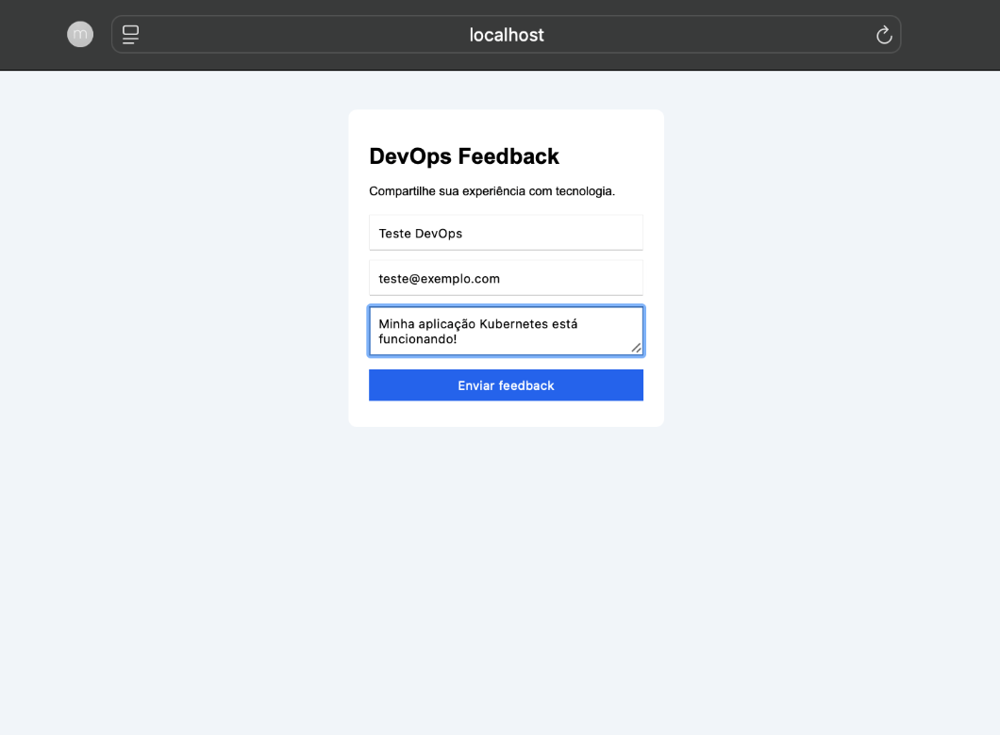
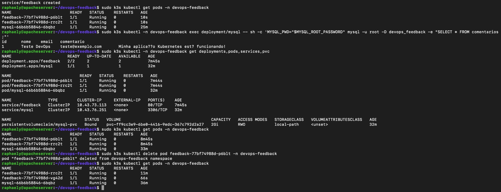

# DevOps Feedback — Deploy com Kubernetes

Projeto desenvolvido durante o Bootcamp DevOps da DIO, com o objetivo de colocar uma aplicação web em funcionamento utilizando Docker, Kubernetes e MySQL.

## Sobre o projeto

O DevOps Feedback é uma aplicação web simples que permite enviar comentários sobre tecnologia.

O usuário informa nome, e-mail e comentário. O backend desenvolvido em Python recebe os dados e os armazena no banco MySQL.

O foco principal do projeto é demonstrar o deploy de uma aplicação conteinerizada, a comunicação entre serviços e o gerenciamento de réplicas pelo Kubernetes.

## Tecnologias utilizadas

- Python e Flask — backend
- HTML e CSS — interface web
- MySQL — banco de dados
- Docker — criação da imagem da aplicação
- Kubernetes (K3s) — orquestração
- Ubuntu — ambiente de execução
- Git e GitHub — versionamento

## Arquitetura

O projeto utiliza um cluster Kubernetes local com um nó.

A aplicação possui duas réplicas do backend Python, gerenciadas por um Deployment.

Um Service Kubernetes distribui as conexões entre os Pods do backend.

O MySQL é executado em um Pod separado e possui um PersistentVolumeClaim de 2 GiB para armazenamento dos dados.

Fluxo da aplicação:

Usuário → Frontend → Service → Backend Flask → Service MySQL → Banco de dados

## Estrutura do projeto

    devops-feedback/
    ├── app/
    │   ├── app.py
    │   ├── Dockerfile
    │   ├── requirements.txt
    │   └── templates/
    │       └── index.html
    ├── database/
    │   └── init.sql
    ├── k8s/
    │   ├── feedback.yaml
    │   └── mysql.yaml
    ├── evidencias/
    │   ├── aplicacao-formulario.png
    │   └── kubernetes-pods-mysql.png
    └── README.md

## Preparação e deploy

O ambiente utilizado possui Ubuntu, Docker e K3s.

Criar o namespace:

    sudo k3s kubectl create namespace devops-feedback

Criar o ConfigMap com o arquivo SQL:

    sudo k3s kubectl -n devops-feedback create configmap mysql-init --from-file=init.sql=database/init.sql

Criar o Secret com as credenciais do banco:

    sudo k3s kubectl -n devops-feedback create secret generic mysql-secret --from-literal=MYSQL_ROOT_PASSWORD="$(openssl rand -hex 16)" --from-literal=MYSQL_DATABASE=devops_feedback --from-literal=MYSQL_USER=feedback --from-literal=MYSQL_PASSWORD="$(openssl rand -hex 16)"

Criar o MySQL:

    sudo k3s kubectl apply -n devops-feedback -f k8s/mysql.yaml

Construir a imagem Docker:

    sudo docker build -t devops-feedback:v1 ./app

Importar a imagem para o K3s:

    sudo docker save devops-feedback:v1 | sudo k3s ctr -n k8s.io images import -

Criar o backend:

    sudo k3s kubectl apply -n devops-feedback -f k8s/feedback.yaml

Verificar os recursos:

    sudo k3s kubectl -n devops-feedback get deployments,pods,services,pvc

A imagem Docker é importada localmente para o K3s. Essa configuração foi utilizada em um cluster de nó único.

## Testes realizados

### Comunicação com o MySQL

Foi realizado um cadastro pela interface web, com confirmação de envio.

Uma consulta SQL confirmou que o comentário foi armazenado na tabela comentarios.

### Réplicas do backend

O Deployment foi configurado com duas réplicas, e ambas foram verificadas em execução.

### Recuperação automática

Um Pod do backend foi excluído manualmente.

O Kubernetes criou um novo Pod automaticamente, restabelecendo as duas réplicas desejadas.

### Armazenamento

O MySQL utiliza um PersistentVolumeClaim de 2 GiB, verificado com status Bound.

A persistência após reinicialização do MySQL não foi testada separadamente.

## Evidências

### Aplicação web

### Kubernetes e MySQL

## Considerações

O projeto utiliza um cluster local de um nó, com duas réplicas do backend.

A arquitetura foi simplificada em relação ao exemplo de três nós apresentado no curso.

O backend foi desenvolvido com Python e Flask, em vez de PHP, para permitir a prática com outra linguagem.

## Referência

Desafio "Criando um Deploy de uma Aplicação", do Bootcamp DevOps da DIO.

Aplicação-base de referência:
https://github.com/denilsonbonatti/k8s-projeto1-app-base

## Versão 2.0 — Pipeline GitLab CI/CD

Evolução do projeto DevOps Feedback, utilizando
integração e entrega contínuas.

### Tecnologias
- Python e Flask
- MySQL
- Docker
- Kubernetes (K3s)
- GitLab CI/CD
- GitLab Runner

### Automação
O pipeline possui duas etapas:

1. Build: construção da imagem Docker.
2. Deploy: atualização automática no Kubernetes.

### Resultados
- Build e Deploy executados com sucesso.
- Aplicação Flask com 2 réplicas disponíveis.
- MySQL em execução.
- Aplicação validada com resposta HTTP 200.

Ambiente de execução: máquina virtual Ubuntu.
